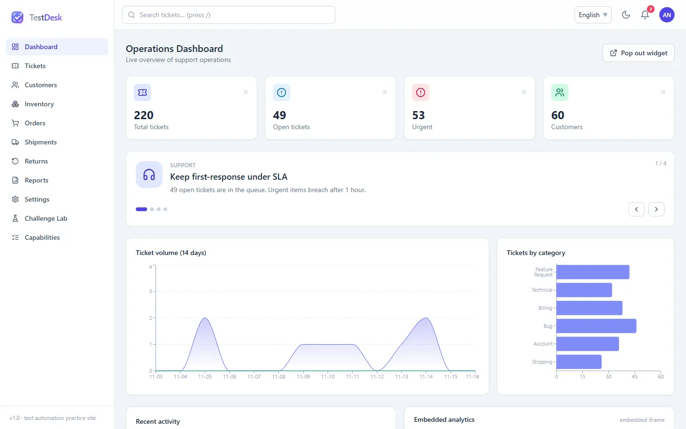

# TestDesk

**A realistic test automation practice website.** TestDesk is a full, production-like web app —
tickets, customers, orders, inventory, reports — built for practicing end-to-end browser
automation with Playwright, Selenium, Cypress, WebdriverIO or an AI agent.

Browser capabilities are not laid out as a page of buttons. They sit **inside believable
workflows**, so you discover triggers the way you would on a real site. A separate **Challenge
Lab** isolates the problems that make real test suites flaky.



---

## Table of contents

- [Features](#features)
- [Quick start](#quick-start)
- [Using TestDesk](#using-testdesk)
- [Pages](#pages)
- [Capability catalog](#capability-catalog)
- [Configuration](#configuration)
- [Tech stack](#tech-stack)
- [Project structure](#project-structure)
- [Architecture](#architecture)
- [Deployment](#deployment)
- [Known behaviors](#known-behaviors)
- [Contributing](#contributing)
- [License](#license)

---

## Features

- **A whole app to test end to end.** Two-step sign-in, a dashboard, tickets (table, board and a
  create wizard), customers, inventory, orders with shipping and returns, reports and settings.
  Changes on one page show up on the others.
- **Your own private data.** Every visitor gets a private copy of the data in their own browser.
  Create, edit and delete freely: nobody else's actions can break your tests. Data is seeded the
  same way every time and can be reset.
- **Real browser behavior.** Real history navigation, `window.open`, `Content-Disposition`
  downloads, `FormData` uploads, native dialogs and cross-origin iframes.
- **79 practice tasks** in [`docs/scenarios.md`](docs/scenarios.md), each with a difficulty tier,
  preconditions, steps and an expected outcome.
- **A Challenge Lab** of 15 hard-to-automate widgets: shadow DOM, nested iframes, unstable IDs,
  moving targets, occlusion, stale elements, canvas, drag and drop, flaky network and more.
- **A configurable backend.** Add latency, a random failure rate or a different page size to
  practice waits and error handling.
- **Locales, themes and RTL.** English, Deutsch and Arabic (right-to-left), light and dark mode.
- **No backend to run.** The API is mocked in the browser, so the whole site is static files.

---

## Quick start

**Prerequisites:** [Node.js](https://nodejs.org/) 24 LTS (see [`.nvmrc`](.nvmrc); with nvm, run
`nvm use`) and npm.

```bash
git clone https://github.com/hhhameem/acmedesk-automation-playground.git
cd acmedesk-automation-playground
npm install
npm run dev
```

Open <http://localhost:4040>. The dev server is pinned to port 4040 and fails instead of
silently switching ports.

| Command | What it does |
| --- | --- |
| `npm run dev` | Start the dev server with hot reload |
| `npm run typecheck` | Type-check the project |
| `npm run build` | Type-check, then build to `dist/` |
| `npm run preview` | Serve the production build on port 4040 |

---

## Using TestDesk

1. **Open the landing page** at `/` and choose **Start practicing**. The landing page also has
   three small challenges you can try without signing in.
2. **Sign in.** The username is `analyst`. The password is shown on the sign-in page and
   **changes on every load**, so read it from the page (`data-testid="hint-password"`) instead
   of hard-coding it.
3. **Enter the one-time code.** Open the demo inbox (`/inbox`, opens in a new tab), read the
   6-digit code and enter it within 60 seconds. Delivery takes a few seconds; you can resend once
   the code expires.
4. **Pick a task.** The **Capabilities** page (`/capabilities`) lists every testable behavior
   with how to trigger it and its difficulty. Work through
   [`docs/scenarios.md`](docs/scenarios.md) as a checklist, then try the **Challenge Lab**
   (`/challenges`).

To start again from the original data, use **Settings → Demo data → Reset demo data**, or open
any page with `?reset=1`.

---

## Pages

| Route | Page | Highlights |
| --- | --- | --- |
| `/` | Landing page | Static, public page about TestDesk with three live mini-challenges |
| `/login` | Sign in | Dynamic password, one-time code from the demo inbox, 60 s expiry, resend |
| `/inbox` | Demo inbox | Receives sign-in codes (opened in a new tab) |
| `/dashboard` | Dashboard | KPIs, charts, activity feed, carousel, embedded analytics iframe, pop-out window |
| `/tickets` | Tickets | Filters in the URL, sorting, pagination, row and context menus, bulk delete, CSV export, board view |
| `/tickets/new` | Ticket wizard | 3-step wizard, rich text editor, date/time picker, shadow-DOM tag input |
| `/tickets/:id` | Ticket detail | Comments, attachments, print view, escalation flow |
| `/customers` | Customers | Virtualized list, random 5–10 s loader |
| `/customers/:id` | Customer detail | Related tickets, documents, contacts |
| `/inventory` | Inventory | Stock table, stock adjustments, low-stock report, CSV export |
| `/orders` | Orders | Filterable list with status counts, filtered CSV export |
| `/orders/new` | New order | Line items, live totals (VAT and shipping), validation |
| `/orders/:id` | Order detail | Items, tracking timeline, ship / advance / refund / cancel, request a return |
| `/shipments` | Shipments | Fulfillment queue, carrier filter, per-row advance |
| `/returns` | Returns | RMA workflow: approve, reject, receive, refund |
| `/reports` | Reports | Generate and download PDF/CSV reports |
| `/settings` | Settings | Appearance, locale, navigation, consent, integrations, backend simulation, reset demo data |
| `/profile` | Profile | Editable profile with validation |
| `/capabilities` | Capabilities | Searchable catalog of every testable behavior |
| `/challenges` | Challenge Lab | Hard-to-automate widgets, grouped by tier |
| `/challenges/:slug` | Challenge | One isolated challenge with a goal and hints |

---

## Capability catalog

The in-app **Capabilities** page documents every capability with its page, how to trigger it and
a difficulty tier. [`docs/scenarios.md`](docs/scenarios.md) breaks the same ground into guided
tasks (`C0`–`C18`, plus adversarial `AD-01`–`AD-09`).

| Area | Examples |
| --- | --- |
| Sign-in | Password that changes every load; one-time code from a demo inbox in a new tab; expiry and resend |
| Tabs and windows | Open in a new tab; `window.open` pop-out; new tab via form submit |
| Navigation and state | Back/forward with filters kept in the URL; multi-step wizard |
| Native dialogs | `alert`, `confirm`, `prompt`, `beforeunload` |
| Modals | Nested, focus-trapped and stacked dialogs |
| Downloads | CSV exports; generated PDF invoices and reports |
| Uploads | File picker, drag and drop, multiple files, type and size validation |
| Iframes | In-app embedded analytics, a nested vendor portal with `postMessage`, a real cross-origin site |
| Async and feedback | Skeletons, random loaders, polling, toasts that disappear |
| Long lists | Paginated tables and a virtualized list |
| Menus and keyboard | Right-click context menu, row action menus, hover menus, keyboard shortcuts |
| Clipboard and print | Copy a ticket link; `window.print` |
| Locale and theme | Dark mode; English, Deutsch and Arabic (RTL) |
| Widgets | Accordion, rich text editor, date/time picker, carousel, drawer, tooltips, sliders |
| Orders and fulfillment | Order creation, shipment steps, returns, with state rules that reject invalid moves |
| Challenge Lab | Shadow DOM, nested iframes, unstable IDs, moving targets, hover-only controls, occlusion, detached DOM, delayed rendering, flaky network, native dialogs, logic gate, drag and drop, infinite scroll, canvas, stale elements |

---

## Configuration

### In the app

**Settings → Backend simulation** shapes the mock API for every open tab:

| Setting | Effect |
| --- | --- |
| Latency | Delay added to every API response |
| Failure rate | Share of requests that fail, to exercise retry and error UI |
| Page size | Rows per page in paginated lists |

**Settings → Appearance / Navigation** sets the theme, density, sidebar mode (pinned or drawer)
and locale. Preferences are saved in `localStorage`.

### Build environment

| Variable | Required | Description |
| --- | --- | --- |
| `VITE_SITE_URL` | For public builds | The site's public address without a trailing slash, e.g. `https://testdesk.example.com`. Used for the canonical link, social preview URLs, structured data, `robots.txt` and `sitemap.xml`. Without it the build still succeeds but skips those and prints a warning. |

Copy [`.env.example`](.env.example) to `.env` to set it locally.

---

## Tech stack

| Concern | Choice |
| --- | --- |
| Framework | React 18, TypeScript, Vite 8 |
| Routing | React Router |
| Server state | TanStack Query |
| UI state | Zustand (persisted, synced across tabs) |
| Mock backend | MSW (Mock Service Worker) |
| Storage | IndexedDB, behind a swappable `DataStore` interface |
| Styling | Tailwind CSS |
| Seed data | @faker-js/faker (fixed seed) |
| Icons and charts | lucide-react, Recharts |

---

## Project structure

```
acmedesk-automation-playground/
├─ docs/
│  └─ scenarios.md            # practice tasks: capability → task → expected outcome
├─ public/
│  ├─ embed/                  # static iframe documents (vendor portal and status widget)
│  ├─ screens/                # landing page screenshots (WebP)
│  ├─ mockServiceWorker.js    # MSW worker
│  ├─ og-image.png, icon-*.png, apple-touch-icon.png, site.webmanifest
│  ├─ _redirects              # Cloudflare Pages: app routes → the app (keep in sync with App.tsx)
│  └─ _headers                # cache headers for static hosting
├─ src/
│  ├─ app/                    # app shell, router, layout
│  ├─ pages/                  # one component per route
│  ├─ components/             # shared UI (modal, menus, tooltip, skeletons, rich text editor…)
│  ├─ features/               # feature modules (tickets, files, Challenge Lab, web components)
│  ├─ mocks/                  # the in-browser backend
│  │  ├─ handlers.ts          #   REST endpoints, validation and business rules
│  │  ├─ store/               #   DataStore interface and the IndexedDB engine
│  │  ├─ data.ts              #   deterministic seed data
│  │  ├─ browser.ts           #   starts the mock backend (and handles ?reset=1)
│  │  └─ config.ts            #   backend simulation settings
│  ├─ store/                  # Zustand stores (auth, ui, toast)
│  ├─ lib/                    # API client, domain types, i18n, OTP, hooks and helpers
│  └─ landing/                # landing page styles and script
├─ index.html                 # static landing page served at "/"
├─ app.html                   # HTML shell of the React app, served for every other path
├─ vite.config.ts             # two-page build, dev routing, SEO output
├─ tailwind.config.js         # app styles
├─ tailwind.landing.config.js # landing page styles
└─ package.json
```

---

## Architecture

### Two entry points

- **`index.html` — the landing page.** Plain HTML with its content in the page, so search
  engines read it without running JavaScript. No script runs before the first paint, its
  stylesheet is inlined at build time, and it loads one small deferred script. It is the only
  page meant to be indexed.
- **`app.html` — the React app.** Served for every other path and marked `noindex`, since its
  pages are behind sign-in. Pages are code-split and show skeletons while they load.

The build adds a canonical link, social preview tags, JSON-LD structured data (including an
`FAQPage` generated from the landing page's FAQ), `robots.txt` and `sitemap.xml`; see
[`VITE_SITE_URL`](#build-environment).

### Data layer

The UI only talks to the REST API (`/api/...`). MSW answers those requests in the browser, and the
handlers read and write through a `DataStore` in [`src/mocks/store`](src/mocks/store):

```ts
await store.read((tx) => tx.filter('tickets', (t) => t.status === 'open'));
await store.write((tx) => tx.update('tickets', id, { status: 'resolved' }));
```

- **`types.ts`** — the interface (`read`, `write`, `reset`, `onExternalChange`) and the record
  types of each collection.
- **`collections.ts`** — copy-on-write transactions: a write that throws changes nothing.
- **`indexeddb.ts`** — the current engine: IndexedDB with a cross-tab lock and a broadcast, so all
  tabs, iframes and pop-out windows share one dataset. Falls back to memory if IndexedDB is
  unavailable.
- **`index.ts`** — the single binding. To use another engine, implement `DataStore` and change
  this one line. Bump `SEED_VERSION` here when seed data or record shapes change.

---

## Deployment

The site is deployed on **Cloudflare Pages**, connected to this repository.

| Setting | Value |
| --- | --- |
| Framework preset | None (or Vite) |
| Build command | `npm run build` |
| Build output directory | `dist` |
| Node.js | 24, read from [`.nvmrc`](.nvmrc). If the project sets the `NODE_VERSION` variable, it must be `24`, because it overrides `.nvmrc`. |
| Build variable | `VITE_SITE_URL`, see [Build environment](#build-environment) |

Routing:

- `/` is the landing page (`index.html`), and other files in `dist/` are served as they are.
- [`public/_redirects`](public/_redirects) lists the app routes (`/login`, `/tickets/*`, ...) and
  serves the React app (`app.html`) for them. **When you add a route to
  [`src/app/App.tsx`](src/app/App.tsx), add it there too**, or the deployed site returns a 404
  for it.
- Any other path gets `404.html`, a copy of `app.html` written by the build, so the app shows
  its Not Found page with a 404 status.
- Do not replace the list with a catch-all `/*` rule. Cloudflare applies `_redirects` rules
  before static files, so `/*` would return the app page for every file, including the landing
  page and the JavaScript bundles.

To try the production build locally with the Pages runtime: `npm run build`, then
`npx wrangler pages dev dist`.

---

## Known behaviors

- **Random loader.** `/customers` and the Dashboard's pop-out window show a loader
  (`data-testid="data-loader"`) for a random 5–10 seconds. This is deliberate, for practicing
  waits.
- **Data is per browser.** Each browser profile, private window or fresh test context starts with
  its own copy of the seed data. Changes persist across reloads in that browser.
- **Mock changes need a hard refresh.** After editing files in `src/mocks/`, reload with
  `Ctrl+Shift+R` so the service worker picks up the new handlers.
- **External iframes.** Settings embeds a real third-party page (`demoqa.com`). Sites that send
  `X-Frame-Options: SAMEORIGIN` cannot be embedded and are not used.
- **Landing page theme.** The landing page follows the system light/dark setting; the app uses
  the theme chosen in Settings.

---

## Contributing

Contributions are welcome: bug reports, new practice scenarios, new challenges and fixes. Please
read [CONTRIBUTING.md](CONTRIBUTING.md) for the development workflow, conventions and the pull
request checklist.

---

## License

No license has been chosen for this project yet, so all rights are reserved by default. Open an
issue if you would like to reuse the code.
